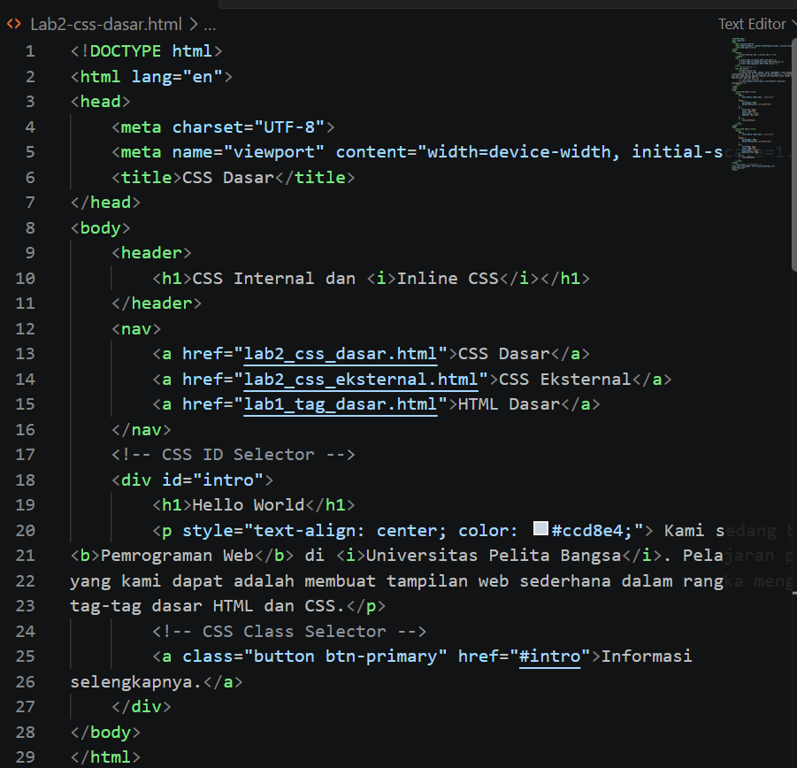
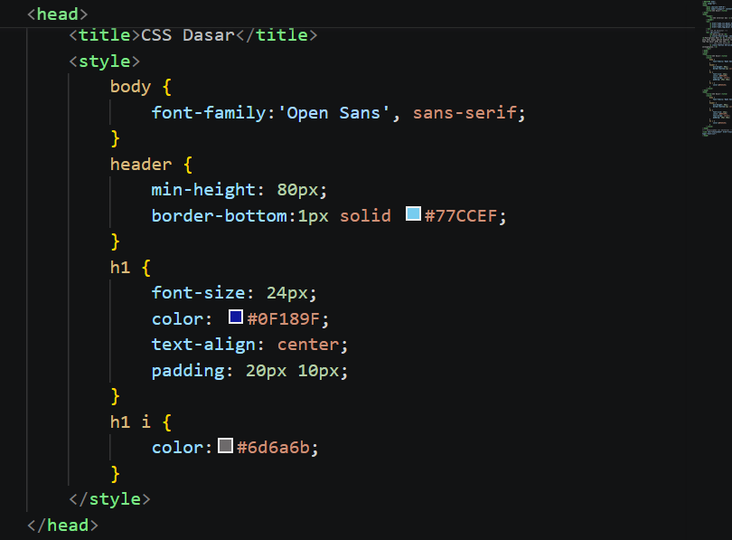
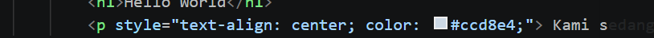
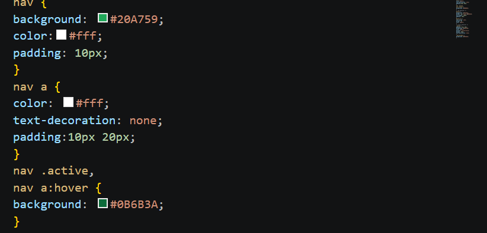
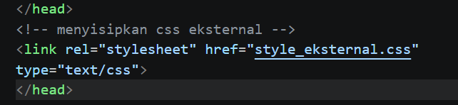
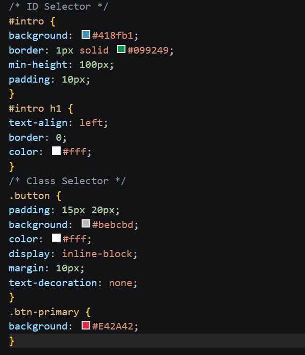

# Lab3Web

## Praktikum Pemrograman Web
### CSS Internal dan Inline CSS

Repository ini berisi hasil praktikum Pemrograman Web dengan materi **CSS Internal dan Inline CSS**. Praktikum dilakukan menggunakan Visual Studio Code dan web browser.

## Tujuan Praktikum

Praktikum ini bertujuan untuk memahami cara penggunaan CSS pada halaman HTML, khususnya:

- CSS Internal
- Inline CSS
- CSS External
- ID Selector
- Class Selector
- Penggunaan properti dan nilai CSS
- Pengaruh selector terhadap tampilan halaman

---

# Langkah Praktikum

## 1. Membuat Struktur HTML

Pada tahap awal dibuat halaman HTML yang berisi header, navigasi, judul `Hello World`, paragraf, dan link informasi.

Struktur HTML juga menggunakan elemen `header`, `nav`, `div`, `h1`, `p`, dan `a`.

### Screenshot 1 – Struktur HTML



Pada kode tersebut terdapat elemen dengan `id="intro"` dan elemen paragraf yang menggunakan inline CSS. Struktur ini menjadi dasar untuk percobaan CSS berikutnya.

---

## 2. Menambahkan CSS Internal

CSS Internal ditulis di dalam tag `<style>` pada bagian `<head>` dokumen HTML.

Beberapa aturan yang digunakan antara lain:

- `body` untuk mengatur jenis font.
- `header` untuk mengatur tinggi minimum dan garis bawah.
- `h1` untuk mengatur ukuran, warna, posisi teks, dan padding.
- `h1 i` untuk mengatur warna teks italic.

### Screenshot 2 – CSS Internal



Pada tahap ini tampilan dasar halaman mulai berubah karena aturan CSS internal sudah diterapkan.

---

## 3. Menggunakan Inline CSS

Inline CSS dituliskan langsung pada atribut `style` sebuah elemen HTML.

Contoh yang digunakan:

```html
<p style="text-align: center; color: #ccd8e4;">
```

Aturan tersebut membuat paragraf menjadi rata tengah dan memiliki warna teks tertentu.

### Screenshot 3 – Inline CSS



Dari percobaan ini dapat dilihat bahwa CSS dapat diterapkan langsung pada elemen tertentu tanpa membuat selector tambahan di dalam `<style>`.

---

## 4. Mengubah Tampilan Navigasi

Pada tahap berikutnya ditambahkan CSS untuk elemen `nav` dan link di dalam navigasi.

Contoh properti yang digunakan:

```css
nav {
    background: #20A759;
    color: #fff;
    padding: 10px;
}

nav a {
    color: #fff;
    text-decoration: none;
    padding: 10px 20px;
}
```

Selain itu digunakan juga selector `:hover` untuk memberikan perubahan warna ketika kursor diarahkan ke menu.

### Screenshot 4 – CSS Navigation



Hasilnya, menu navigasi memiliki latar hijau dan teks berwarna putih sehingga tampilannya lebih rapi.

---

## 5. Menghubungkan CSS External

Selain CSS Internal dan Inline CSS, praktikum juga menggunakan CSS External.

CSS external dihubungkan menggunakan:

```html
<link rel="stylesheet" href="style_external.css" type="text/css">
```

Dengan cara ini aturan CSS disimpan pada file terpisah sehingga dapat digunakan untuk mengatur tampilan halaman.

### Screenshot 5 – CSS External



Penggunaan CSS External membuat file HTML dan CSS menjadi terpisah sehingga pengelolaan kode lebih mudah.

---

## 6. Menggunakan ID Selector dan Class Selector

Pada tahap ini digunakan ID selector dan class selector.

Contoh ID selector:

```css
#intro {
    background: #418fb1;
    border: 1px solid #099249;
    min-height: 100px;
    padding: 10px;
}

#intro h1 {
    text-align: left;
    border: 0;
    color: #fff;
}
```

Contoh class selector:

```css
.button {
    padding: 15px 20px;
    background: #bebcbd;
    color: #fff;
    display: inline-block;
    margin: 10px;
    text-decoration: none;
}

.btn-primary {
    background: #E42A42;
}
```

### Screenshot 6 – ID dan Class Selector



Pada percobaan ini dapat dilihat bahwa ID selector menggunakan tanda `#`, sedangkan class selector menggunakan tanda titik `.`.

---

# Eksperimen CSS

Beberapa properti CSS yang dicoba selama praktikum yaitu:

| Properti | Fungsi |
|---|---|
| `color` | Mengatur warna teks |
| `background` | Mengatur warna atau latar belakang |
| `font-size` | Mengatur ukuran teks |
| `text-align` | Mengatur posisi teks |
| `padding` | Mengatur jarak bagian dalam elemen |
| `margin` | Mengatur jarak luar elemen |
| `display` | Mengatur cara elemen ditampilkan |
| `border` | Memberikan garis pada elemen |
| `text-decoration` | Mengatur dekorasi teks |
| `:hover` | Mengatur tampilan ketika kursor diarahkan ke elemen |

---

# Kesimpulan

Dari praktikum yang telah dilakukan, dapat dipahami bahwa CSS digunakan untuk mengatur tampilan elemen HTML. CSS dapat ditulis secara internal di dalam tag `<style>`, secara inline melalui atribut `style`, maupun secara external pada file CSS terpisah.

Praktikum juga menunjukkan perbedaan penggunaan ID selector dan class selector. ID menggunakan tanda `#`, sedangkan class menggunakan tanda `.`. Dengan menggunakan selector yang tepat, tampilan setiap bagian halaman dapat diatur sesuai kebutuhan.

Perubahan pada warna, background, padding, margin, ukuran teks, navigasi, dan tombol menunjukkan bahwa CSS sangat berpengaruh terhadap tampilan halaman web.

---

## Repository

**Nama Repository:** `Lab3Web`

**URL Repository:**  
`........................................................................`

## Identitas

- **Nama:** ........................................................
- **NIM:** .........................................................
- **Kelas:** .......................................................
- **Mata Kuliah:** Pemrograman Web
